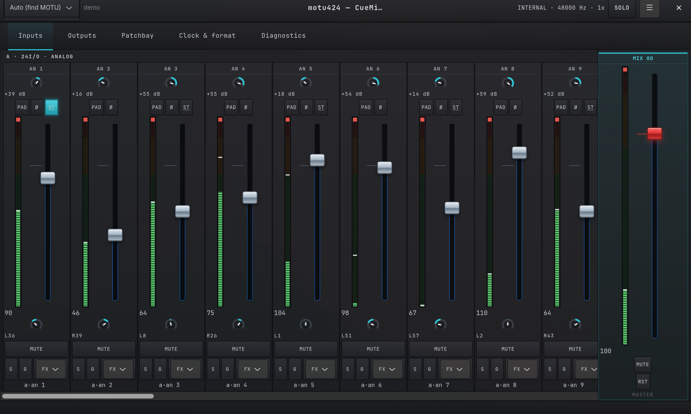
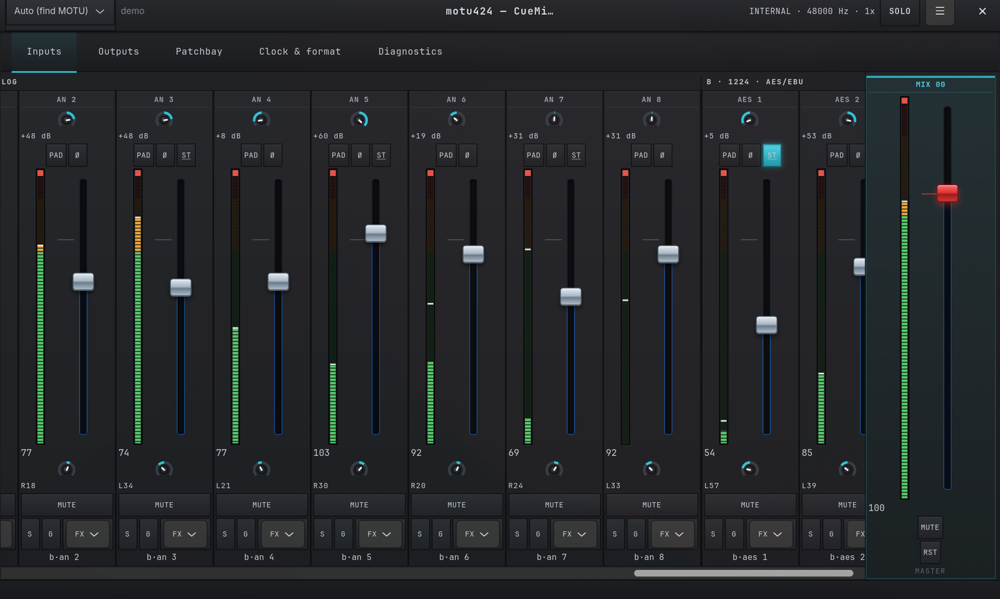
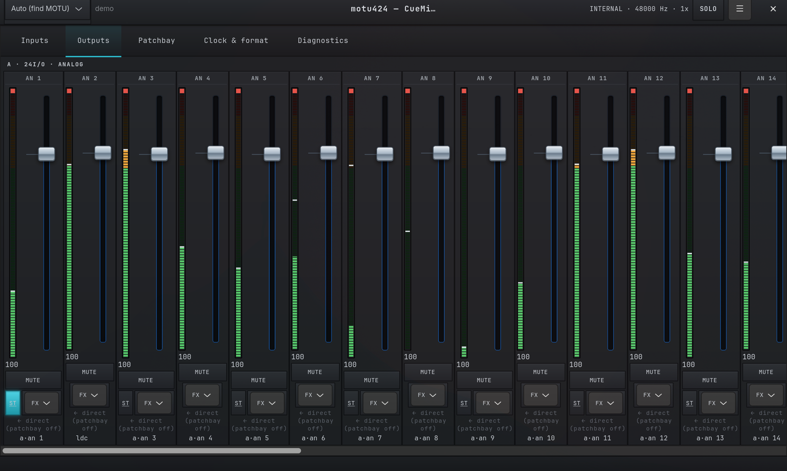
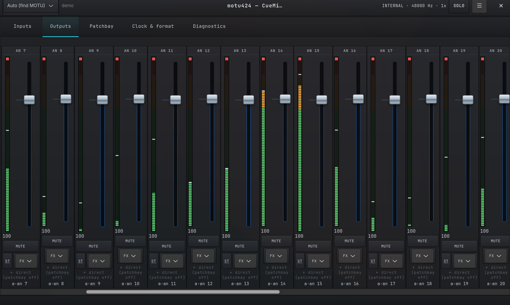
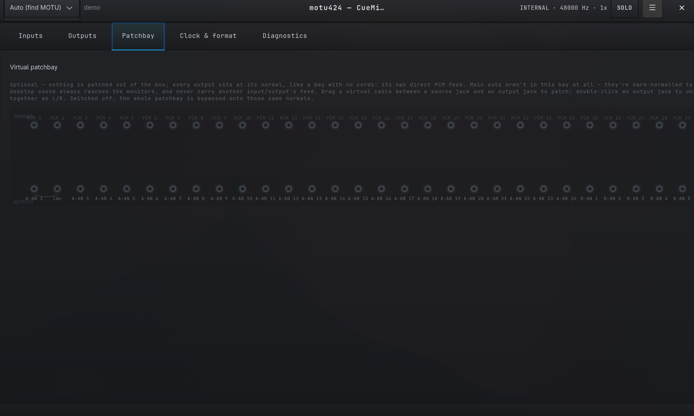
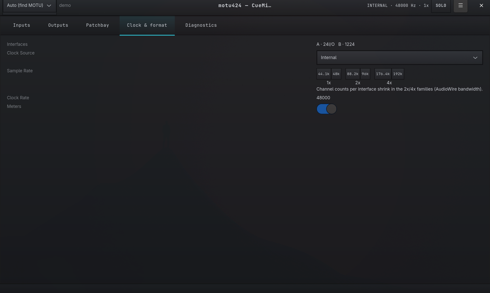
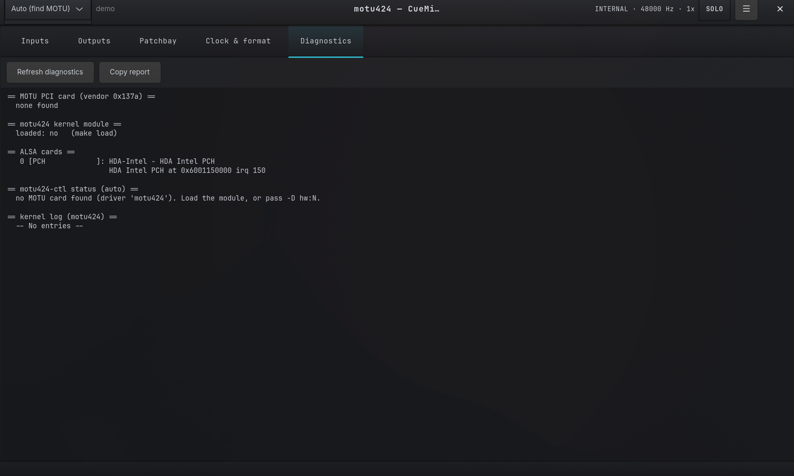

# motu-pci-424

*Lire dans une autre langue : [English](README.md) · **Français***

🌐 **Site web :** <https://devfrp.github.io/Linux-motu-pci-424/>

Un pilote ALSA Linux écrit de zéro pour la carte audio **MOTU PCI-324 / PCI-424**
et ses interfaces de sortie AudioWire (2408, 24I/O, 828, HD192, 896HD, …).

> **État : la carte démarre sous Linux ; aucun son n'a encore été joué.** Toute
> la mécanique PCI / IRQ / ALSA est complète. Sur une vraie PCI-424, la
> séquence de chargement (image FPGA via le GPIO du DSP, programme DSP, boîte
> aux lettres) a tourné avec `tools/motu424-bringup`, et le pilote fait
> désormais la même chose quand il s'attache à la carte, avec `request_firmware()`
> (voir [Firmware](#firmware)). L'audio passe par le DMA du DSP depuis un anneau
> en mémoire hôte. Le chemin de flux a tourné sur une carte, mais les sorties
> restaient muettes faute de la configuration constructeur, désormais écrite et
> pas encore testée. Le flux reste coupé sauf avec `motu424.frame_bytes=96`.
> Lecture seule, 48 kHz seulement, PCI-424
> (`137a:0004`) seulement pour l'instant.

## Démarrage rapide

```sh
curl -fsSL https://raw.githubusercontent.com/devfrp/Linux-motu-pci-424/main/get.sh | sh
```

Installe sur n'importe quelle distro (dépendances + module DKMS + outils).
Détails et options dans [Installation](#installation-toute-distro).

## Organisation

| Chemin | Rôle |
|--------|------|
| `kernel/motu424.h` | Définitions partagées + le **modèle matériel rétro-conçu** (source de vérité unique) |
| `kernel/motu424_main.c` | Attach/detach PCI, gestion des ressources + IRQ, gestionnaire d'interruption |
| `kernel/motu424_hw.c` | **Abstraction matérielle — le seul fichier avec la vraie sémantique des registres** |
| `kernel/motu424_pcm.c` | Callbacks PCM ALSA (lecture ; capture quand le format de l'anneau sera connu) |
| `tools/motu424-portregs.py` | Décodage en lecture seule des trois registres du port d'E/S (HSR/HDCR/DSPP, TI SPRU581C) |
| `tools/motu424-bringup.c` | **Rejeu du démarrage** (simulation par défaut) : chargement du FPGA via le GPIO du DSP, chargement du programme DSP, DSPINT, lecture de la boîte aux lettres |
| `tools/motu424-probe.c` | Énumérateur/dumpeur de BARs (modèle fenêtré) en espace utilisateur pour la rétro-ingénierie |
| `tools/motu424-ctl.c` | **CLI de gestion façon CueMix** (horloge/format + mixeur de monitoring) via alsa-lib |
| `tools/motu424-gui` | **Console de mixage GTK4** façon CueMix FX (front-end de `motu424-ctl`) |
| `tools/re/` | Aides à la RE statique (`vtable-scan.py`, `xref.py` basé sur capstone, `extract-firmware.py`, `dis-c64x.py` pour le C64x) |
| `get.sh` | **Bootstrap `curl \| sh`** — récupère les sources + lance l'installeur |
| `install.sh` | **Installeur multi-distro** (dépendances + DKMS + outils) |
| `ARCHITECTURE.md` | Notes de conception : la séparation en 3 couches + la règle de confinement matériel |
| `CLEANROOM.md` | Énoncé clean-room & provenance (base légale, méthode de RE) |
| `docs/index.html` | Site du projet (page GitHub Pages) |
| `dkms.conf` | Empaquetage DKMS pour la reconstruction automatique à chaque noyau |

Objectif de conception : **toute l'incertitude est confinée à `motu424.h` +
`motu424_hw.c`.** Une fois la vraie disposition des registres connue, seuls ces
deux fichiers changent.

## Installation (toute distro)

Une ligne — récupère les sources et lance l'installeur :

```sh
curl -fsSL https://raw.githubusercontent.com/devfrp/Linux-motu-pci-424/main/get.sh | sh
# passer des options à l'installeur :
curl -fsSL https://raw.githubusercontent.com/devfrp/Linux-motu-pci-424/main/get.sh | sh -s -- --no-dkms -y
```

Ou clonez et lancez l'installeur directement. Il détecte votre gestionnaire de
paquets (pacman/apt/dnf/yum/zypper/apk/xbps), tire les dépendances de build,
installe le module via **DKMS** (pour qu'il survive aux mises à jour du noyau) et
installe les outils :

```sh
./install.sh              # deps + DKMS + outils + chargement (utilise sudo au besoin)
./install.sh -y           # installation de paquets non interactive
./install.sh --no-dkms    # build in-tree + install au lieu de DKMS
./install.sh --uninstall  # retire le module + les outils
./install.sh -h           # toutes les options
```

Sous `curl | sh`, l'installeur détecte l'absence de terminal et bascule
automatiquement les installations de paquets en mode non interactif ; sudo
demande son mot de passe via le terminal comme d'habitude.

## Build (manuel)

Nécessite les en-têtes du noyau en cours (Arch : `linux-rt-headers` pour un
noyau RT, sinon `linux-headers`) et `alsa-lib` pour `motu424-ctl`.

```sh
make            # build module + outils
make load       # insmod kernel/motu424.ko
dmesg | tail    # chercher « MOTU PCI-4xx registered as ALSA card N »
aplay -l        # la carte devrait apparaître
make unload
```

### Gérer la carte (CueMix pour Linux)

`tools/motu424-ctl` est l'appli de contrôle en espace utilisateur — l'équivalent
Linux du CueMix FX de MOTU. Elle localise automatiquement la carte MOTU et gère
les kcontrols du mixeur ALSA du pilote (source d'horloge, fréquence
d'échantillonnage, trim/pad/phase par entrée, et la matrice de monitoring
entrées×bus). Jeu de contrôles + nommage : [`docs/cuemix-control-map.md`](docs/cuemix-control-map.md).

```sh
make tools                              # compile motu424-ctl si alsa-lib est présent
./tools/motu424-ctl                     # aperçu d'état façon CueMix
./tools/motu424-ctl list                # tous les contrôles
./tools/motu424-ctl set 'Clock Source' Internal
./tools/motu424-ctl set 'Mix 00 Input 03 Volume' 92
```

Les contrôles du mixeur relèvent de la Phase 5 (dépendante de la carte) ; l'appli
est écrite pour s'activer automatiquement dès que le pilote les enregistre, et se
dégrade proprement en leur absence.

#### Console graphique

`tools/motu424-gui` est une **console de mixage GTK4 façon CueMix FX** — un
front-end au-dessus de `motu424-ctl`, de sorte que la CLI testée reste la
source de vérité unique. Elle reconstruit le modèle CueMix à partir des noms de
kcontrols et le rend comme la vraie console : un onglet par bus de mix
(tranches avec fader d'envoi, vumètre à maintien de crête, potentiomètre de
panoramique rotatif, mute/solo/gang, le master du bus épinglé à droite), un
onglet Entrées (gain, pad, phase, paires stéréo), un onglet Sorties (tranches
de monitoring mono, liables en paires stéréo comme les entrées), un onglet
Patchbay (optionnel, sans cordons d'origine — dessiné comme une vraie baie de
brassage normalisée : chaque sortie est à son « normal », les main out étant
normalisées sur le programme stéréo du système pour que le son du PC sorte sur
les moniteurs sans configuration ; on tire des câbles virtuels à la souris
pour patcher le reste ; survoler un jack montre ce qu'il porte, « Unpatch
all » retire tous les cordons en une seule étape annulable, et un
interrupteur global contourne la baie en retombant sur ces normals), un
onglet Horloge & format, et un onglet Diagnostics qui fonctionne même sans
carte ni pilote chargé.

Toute la disposition s'adapte aux convertisseurs reliés aux slots AudioWire de
la PCI-424 : le pilote nomme chaque canal par slot et par banque (analogique,
ADAT, TDIF, AES/EBU, main out, casque — voir `docs/cuemix-control-map.md`), et
la console regroupe ses tranches et les jacks du patchbay sous des en-têtes
« slot · modèle — banque ». Une 24I/O apporte 24 entrées/sorties analogiques,
une 1224 apporte 8 entrées/sorties analogiques plus une paire AES/EBU et des
sorties main — c'est exactement la combinaison que simule `--demo`, et
`--rig 24io,2408` accroche d'autres convertisseurs (24io, 1224, 2408, hd192)
aux quatre slots AudioWire à la place. La console
suit aussi la carte dans le temps : quand le jeu de contrôles enregistrés
change (chargement/déchargement du module, boîtiers branchés à chaud, nombre
de canaux qui rétrécit aux familles 2x/4x), elle se reconstruit au poll
suivant en conservant l'onglet actif — changez la fréquence dans `--demo`
pour voir le rétrécissement en direct.

Au-delà des bases : liaison paires stéréo et gangs, scènes A/B, boutons
TALK / LISTEN (talkback) dans l'en-tête (maintenir = momentané, clic bref =
verrouillé), copie/reset de mix par bus, snapshots
de mix en JSON (Ctrl+S / Ctrl+O), annulation Ctrl+Z des
opérations globales, noms de canaux éditables, et un dialogue « Shortcuts &
tips » sur F1. Les écritures de contrôles sont regroupées dans un thread de
travail et le matériel est re-sondé en arrière-plan : la console suit les
changements faits ailleurs (alsamixer, une seconde instance) sans se battre
avec le contrôle que vous manipulez.

```sh
./install.sh --gui        # installe le lanceur + ses dépendances d'exécution
motu424-gui               # ou depuis le menu d'applications (« MOTU CueMix »)
motu424-gui --demo        # console complète sur un rig 24I/O + 1224 synthétique
```

Nécessite `python-gobject` + `gtk4` (ajoutés automatiquement par `--gui`). Les
kcontrols du mixeur relèvent de la Phase 5 (dépendante de la carte) : sans carte
MOTU la console n'a rien à afficher — prévisualisez-la avec `--demo` ; sur du
vrai matériel elle se remplit automatiquement dès que le pilote enregistre ses
contrôles.

##### Captures d'écran

`--demo` sur le rig synthétique 24I/O + 1224, un onglet à la fois :

**Inputs** — tranches de canaux, défilées du slot A (24I/O, analogique) au
slot B (1224, AES/EBU), avec le master du mix épinglé à droite :

 

**Outputs** — tranches de sortie mono, défilées sur les sorties analogiques du 24I/O :

 

**Patchbay** — sans cordon par défaut ; chaque jack reste à son normal :



**Clock & format** et **Diagnostics** (ce dernier fonctionne sans carte ni
pilote chargé — c'est un rapport réel de la machine où ces captures ont été prises) :

 

## Firmware

Le FPGA de la PCI-424 n'a pas de PROM de configuration : l'hôte le charge, ainsi
que le programme du DSP, chaque fois que le pilote s'attache à la carte (comme
le pilote Windows). Les deux images appartiennent à MOTU et ne sont **pas**
fournies ici. Extrayez-les de votre propre copie du pilote constructeur et
installez-les :

```sh
python3 tools/re/extract-firmware.py chemin/vers/MOTUAW.sys   # pilote 32 bits ; écrit vendor/firmware/ (ignoré par git)
sudo install -Dm644 vendor/firmware/pci424-serial-container.bin \
    /lib/firmware/motu424/pci424-serial-container.bin
sudo install -Dm644 vendor/firmware/pci424-program.bin \
    /lib/firmware/motu424/pci424-program.bin
```

Le pilote vérifie la taille et le SHA-256 des deux fichiers et refuse de
s'attacher si l'un manque ou diffère. Sur la carte de test, le chargement a pris
environ 15 s depuis l'espace utilisateur (894k écritures GPIO) ; ensuite `dmesg`
affiche `DSP running: audio_base=0x6fac ...`.

Facultatif, pour les testeurs : `/lib/firmware/motu424/pci424-mixer.bin`, un
programme de mixage CueMix récupéré sur une carte configurée par Windows.
Redémarrez à chaud depuis Windows, videz la RAM du DSP avec `sudo
tools/motu424-ringwatch.py --dump ram.bin` avant de charger le pilote, puis
découpez le programme pointé par `+0x78`, jusqu'à sa signature de fin
`e2 00 1c 00 e2 03 98 07 00 80 00 00` incluse. Sur la carte de test, c'était
0x4fc octets à `0x32800` :
`dd if=ram.bin of=pci424-mixer.bin bs=1 skip=$((0x32800)) count=$((0x4fc))`.
Ce sont vos propres données de routage, jamais distribuées. Si le fichier est
présent, le pilote le transmet au DSP au chargement (`docs/transport.md`,
Device configure).

## Rétro-ingénierie

Le modèle matériel vient du pilote Windows constructeur `MOTUAW.sys` (RE
statique avec `objdump`, `tools/re/vtable-scan.py`, `tools/re/xref.py`), du
programme du DSP de la carte (`tools/re/dis-c64x.py`) et d'essais sur une vraie
PCI-424 dans l'issue #2 :

- **La carte** est un **DSP TI TMS320C6412** en mode de boot PCI, plus un FPGA
  sans PROM. La BAR d'I/O est le Host Port Interface du DSP (HSR/HDCR/DSPP) ;
  la BAR de 8 Mo (fenêtre A) contient les registres périphériques du DSP, celle
  de 4 Mo (fenêtre B) sa mémoire, avec la RAM interne en `0..0x3ffff`.
- **Démarrage** (`fn 0x2c150` du constructeur, testé sur la carte) : WARMRESET,
  image FPGA envoyée bit à bit via le GPIO du DSP, programme C64x de 28 272
  octets écrit en RAM interne, DSPINT, puis le programme publie `audio_base`
  dans la boîte aux lettres en `0x3fffc` (`0x6fac`).
- **Le bloc audio** à `audio_base` est la zone de données globales du programme
  DSP : `mix_base` en `+0`, l'adresse de l'anneau hôte en `+0x5c`, la position
  du DSP en `+0x2c`, démarrage/arrêt en `+0x54`/`+0xf4`, trames par
  interruption en `+0x60`.
- **Le transport est du DMA piloté par le DSP.** L'hôte donne au DSP un anneau
  cohérent (512 Ko sous Windows) ; le DSP y lit l'audio lui-même et lève une
  interruption toutes les 64 trames. IRQ en attente = bit 1 de HSR ; acquittement
  = `0x10` (INTRST) dans le registre RSTSRC du DSP.
- **Jeu de contrôles CueMix** décodé depuis le `CueMixFX-PCI-424.touchosc`
  livré (l'API OSC CueMix de MOTU) : une matrice de monitoring entrée×bus de
  mix + le conditionnement analogique par entrée + horloge/format. Pilote
  `tools/motu424-ctl` — voir
  [`docs/cuemix-control-map.md`](docs/cuemix-control-map.md).

Les rédactions détaillées, étiquetées par niveau de preuve, vivent dans `docs/` :
[`register-map.md`](docs/register-map.md), [`transport.md`](docs/transport.md),
[`fpga-upload.md`](docs/fpga-upload.md),
[`cuemix-control-map.md`](docs/cuemix-control-map.md),
[`vendor-driver-map.md`](docs/vendor-driver-map.md).

Encore ouvert : le format d'une trame dans l'anneau hôte (octets par trame,
format des échantillons, ordre des canaux), l'endroit où arrive la capture côté
hôte, les changements de fréquence (la séquence de « relock » du constructeur),
et les chemins de chargement de la PCI-324 et de la PCIe-424.

La feuille de route complète et par phases, d'ici à un pilote 100 % fonctionnel,
vit dans [`docs/REVERSE_ENGINEERING_PLAN.md`](docs/REVERSE_ENGINEERING_PLAN.md).

## Licence

GPL-2.0-or-later. Les modules noyau liant des symboles ALSA GPL-only doivent être GPL.
