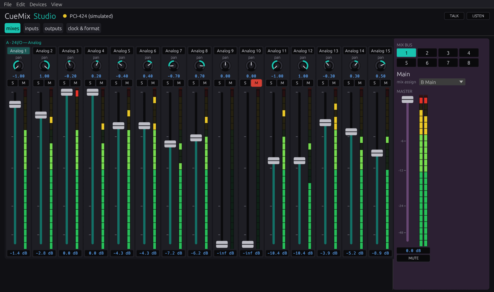
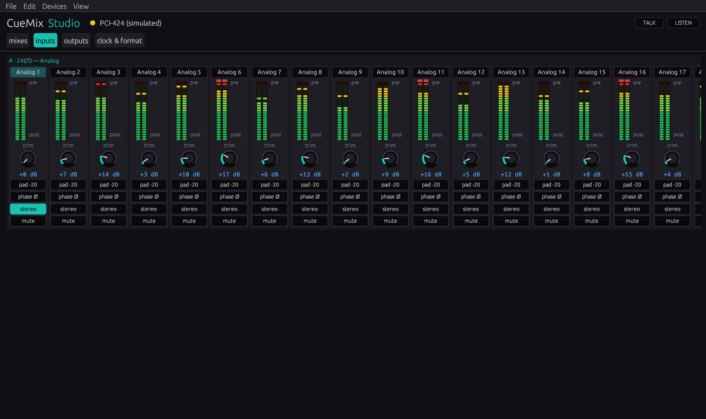
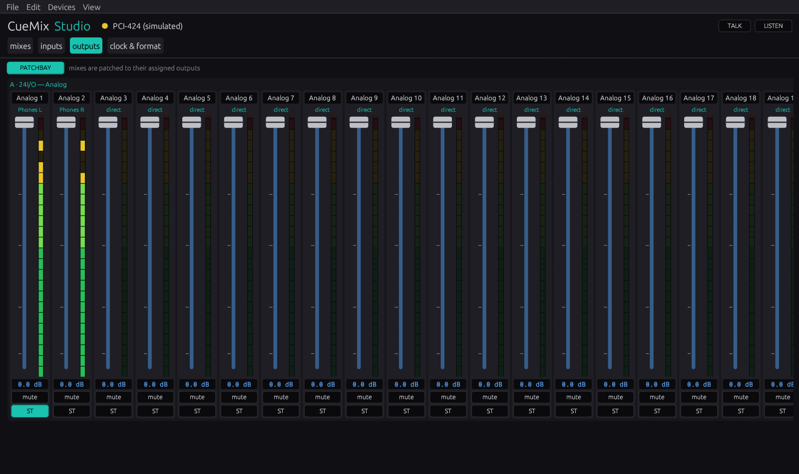
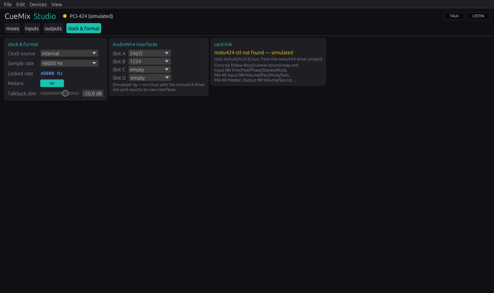
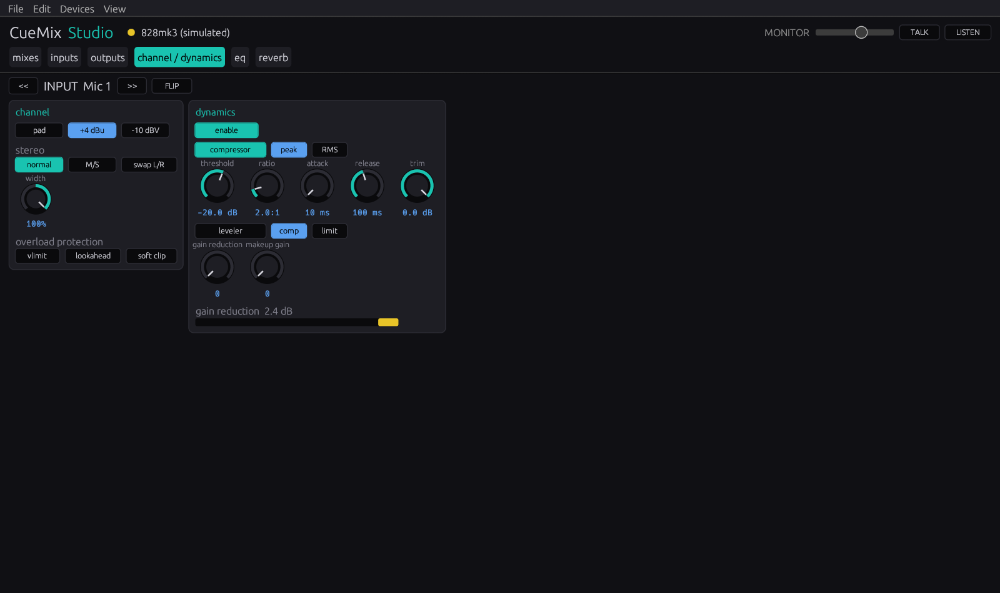
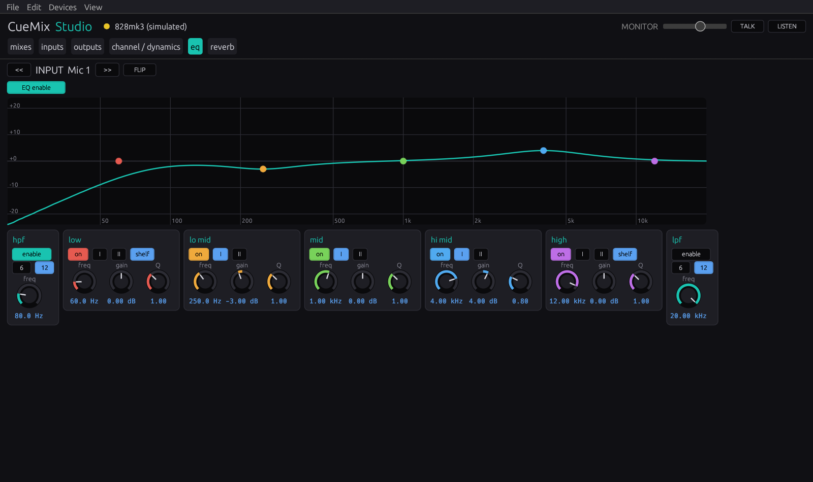
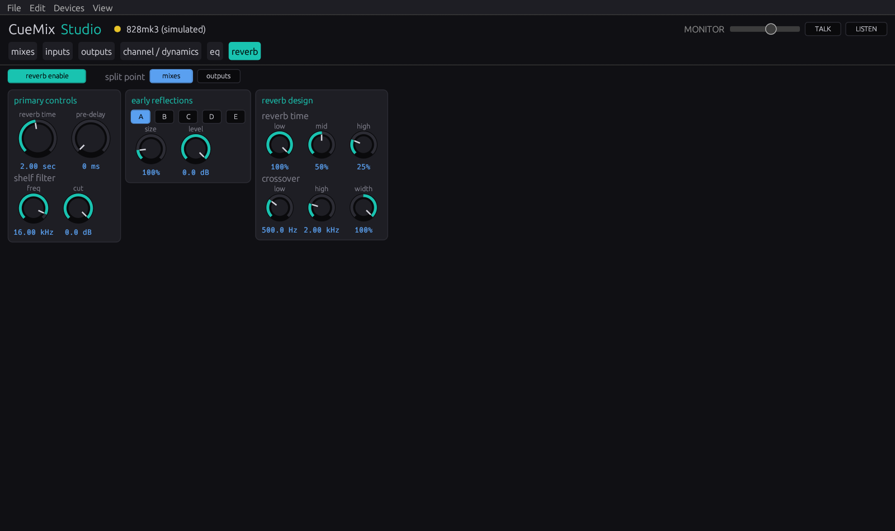

# motu-pci-424

*Lire dans une autre langue : [English](README.md) · **Français***

🌐 **Site web :** <https://devfrp.github.io/Linux-motu-pci-424/>

Un pilote ALSA Linux écrit de zéro pour la carte audio **MOTU PCI-324 / PCI-424**
et ses interfaces de sortie AudioWire (2408, 24I/O, 828, HD192, 896HD, …).

> **État : la carte démarre sous Linux ; aucun son n'a encore été joué.** Toute
> la mécanique PCI / IRQ / ALSA est complète. Sur une vraie PCI-424, la
> séquence de chargement (image FPGA via le GPIO du DSP, programme DSP, boîte
> aux lettres) a tourné avec `tools/motu424-bringup`, et le pilote fait
> désormais la même chose quand il s'attache à la carte, avec `request_firmware()`
> (voir [Firmware](#firmware)). L'audio passe par le DMA du DSP depuis un anneau
> en mémoire hôte. Sur une vraie carte, le chargement, la configuration
> constructeur et le flux tournent, et la carte détecte ses interfaces
> AudioWire, mais celles-ci ne se verrouillent jamais sur elle : rien ne sort.
> Tous les registres et mots du DSP visibles depuis l'hôte correspondent
> désormais à une carte Windows verrouillée ; la pièce manquante est dans le
> sens carte vers interfaces, et il faut un oscilloscope ou une VM Windows
> tracée pour la trouver ([`docs/transport.md`](docs/transport.md), Open).
> Le flux reste coupé sauf avec `motu424.frame_bytes=96`.
> Lecture seule, 48 kHz seulement, PCI-424
> (`137a:0004`) seulement pour l'instant.

## Démarrage rapide

```sh
curl -fsSL https://raw.githubusercontent.com/devfrp/Linux-motu-pci-424/main/get.sh | sh
```

Installe sur n'importe quelle distro (dépendances + module DKMS + outils).
Détails et options dans [Installation](#installation-toute-distro).

## Organisation

| Chemin | Rôle |
|--------|------|
| `kernel/motu424.h` | Définitions partagées + le **modèle matériel rétro-conçu** (source de vérité unique) |
| `kernel/motu424_main.c` | Attach/detach PCI, gestion des ressources + IRQ, gestionnaire d'interruption |
| `kernel/motu424_hw.c` | **Abstraction matérielle — le seul fichier avec la vraie sémantique des registres** |
| `kernel/motu424_pcm.c` | Callbacks PCM ALSA (lecture ; capture quand le format de l'anneau sera connu) |
| `kernel/rust/` | **Le même pilote en Rust** (`hw.rs` suit `motu424_hw.c`) : demande un noyau `CONFIG_RUST`, pas encore lancé sur une carte. Voir [Module noyau Rust](#module-noyau-rust) |
| `tools/` | **Les outils en espace utilisateur, tous en Rust** : un workspace Cargo, `make tools` les compile dans `tools/target/release/` |
| `tools/motu424-ctl` | **CLI de gestion façon CueMix** (horloge/format + mixeur de monitoring) via alsa-lib |
| `tools/cuemix-studio` | **Console de mixage** (Rust/egui, Linux/macOS/Windows) : pilote la carte via `motu424-ctl` sous Linux, rig simulé ailleurs ; ajoute les pages EQ/dynamique/réverb de la 828mk3 |
| `tools/motu424-probe` | Énumérateur/dumpeur de BARs (modèle fenêtré) pour la rétro-ingénierie |
| `tools/motu424-portregs` | Décodage en lecture seule des trois registres du port d'E/S (HSR/HDCR/DSPP, TI SPRU581C) |
| `tools/motu424-bringup` | **Rejeu du démarrage** (simulation par défaut) : chargement du FPGA via le GPIO du DSP, chargement du programme DSP, DSPINT, lecture de la boîte aux lettres |
| `tools/motu424-ringwatch` | Échantillonneur en lecture seule de la position du DSP dans l'anneau pendant un flux ; `--dump` sauvegarde la RAM du DSP |
| `tools/stream-run.sh` | Test de flux scripté autour de `motu424-ringwatch` (chargement, 12 s de `speaker-test`, déchargement) |
| `tools/motu424-card` | La bibliothèque partagée par les outils de la carte (recherche sysfs, mappage des BAR, E/S de port) |
| `tools/re/` | Aides à la RE statique : `extract-firmware`, `dis-c64x` (C64x), `xref`, `vtable-scan`, `re-devext`, `disasm-va`, `ram-diff` |
| `get.sh` | **Bootstrap `curl \| sh`** — récupère les sources + lance l'installeur |
| `install.sh` | **Installeur multi-distro** (dépendances + DKMS + outils) |
| `ARCHITECTURE.md` | Notes de conception : la séparation en 3 couches + la règle de confinement matériel |
| `CLEANROOM.md` | Énoncé clean-room & provenance (base légale, méthode de RE) |
| `docs/index.html` | Site du projet (page GitHub Pages) |
| `dkms.conf` | Empaquetage DKMS pour la reconstruction automatique à chaque noyau |

Objectif de conception : **toute l'incertitude est confinée à `motu424.h` +
`motu424_hw.c`.** Une fois la vraie disposition des registres connue, seuls ces
deux fichiers changent, plus `kernel/rust/hw.rs`, leur portage dans le module
Rust.

## Installation (toute distro)

Une ligne — récupère les sources et lance l'installeur :

```sh
curl -fsSL https://raw.githubusercontent.com/devfrp/Linux-motu-pci-424/main/get.sh | sh
# passer des options à l'installeur :
curl -fsSL https://raw.githubusercontent.com/devfrp/Linux-motu-pci-424/main/get.sh | sh -s -- --no-dkms -y
```

Ou clonez et lancez l'installeur directement. Il détecte votre gestionnaire de
paquets (pacman/apt/dnf/yum/zypper/apk/xbps), tire les dépendances de build,
installe le module via **DKMS** (pour qu'il survive aux mises à jour du noyau) et
installe les outils :

```sh
./install.sh              # deps + DKMS + outils + chargement (utilise sudo au besoin)
./install.sh -y           # installation de paquets non interactive
./install.sh --no-dkms    # build in-tree + install au lieu de DKMS
./install.sh --rust       # le module Rust au lieu du C (noyaux CONFIG_RUST)
./install.sh --uninstall  # retire le module + les outils
./install.sh -h           # toutes les options
```

Sous `curl | sh`, l'installeur détecte l'absence de terminal et bascule
automatiquement les installations de paquets en mode non interactif ; sudo
demande son mot de passe via le terminal comme d'habitude.

## Build (manuel)

Nécessite les en-têtes du noyau en cours (Arch : `linux-rt-headers` pour un
noyau RT, sinon `linux-headers`) et `alsa-lib` pour `motu424-ctl`.

```sh
make            # build module + outils
make load       # insmod kernel/motu424.ko
dmesg | tail    # chercher « MOTU PCI-4xx registered as ALSA card N »
aplay -l        # la carte devrait apparaître
make unload
```

### Module noyau Rust

`kernel/rust/` est le même pilote écrit en Rust : le pilote PCI, le chargement
du FPGA et du programme DSP (avec sa vérification SHA-256), le flux audio,
l'IRQ et l'ordre d'arrêt sont en Rust, et `hw.rs` suit `motu424_hw.c` étape
par étape. La carte ALSA et les paramètres du module restent dans un petit
fichier C (`motu424_alsa.c`), car le noyau n'a pas d'interface Rust pour ALSA
et les paramètres de module Rust ne sont que des entiers. Il produit le même
`motu424.ko`, avec les mêmes paramètres, identifiants PCI et noms de firmware :
on charge l'un ou l'autre, pas les deux.

**Il n'a pas encore tourné sur une carte.** Le module C de `kernel/` est celui
testé sur une vraie PCI-424 et reste celui par défaut.

Il faut un noyau compilé avec `CONFIG_RUST`, et exactement le `rustc` qui a
compilé ce noyau (`grep RUSTC_VERSION_TEXT /lib/modules/$(uname -r)/build/.config`
l'affiche ; sous Arch c'est le paquet `rust`, pas rustup) :

```sh
make module-rust   # compile kernel/rust/motu424.ko
make load-rust     # le charge (insmod)
./install.sh --rust   # ou l'installe (sans DKMS) à la place du module C
```

### Gérer la carte (CueMix pour Linux)

`tools/motu424-ctl` est l'appli de contrôle en espace utilisateur — l'équivalent
Linux du CueMix FX de MOTU. Elle localise automatiquement la carte MOTU et gère
les kcontrols du mixeur ALSA du pilote (source d'horloge, fréquence
d'échantillonnage, trim/pad/phase par entrée, et la matrice de monitoring
entrées×bus). Jeu de contrôles + nommage : [`docs/cuemix-control-map.md`](docs/cuemix-control-map.md).

```sh
make tools                                      # nécessite Cargo ; motu424-ctl nécessite alsa-lib
tools/target/release/motu424-ctl                # aperçu d'état façon CueMix
tools/target/release/motu424-ctl list           # tous les contrôles
tools/target/release/motu424-ctl set 'Clock Source' Internal
tools/target/release/motu424-ctl set 'Mix 00 Input 03 Volume' 92
```

Les contrôles du mixeur relèvent de la Phase 5 (dépendante de la carte) ; l'appli
est écrite pour s'activer automatiquement dès que le pilote les enregistre, et se
dégrade proprement en leur absence.

#### Console graphique (cuemix-studio)

[`tools/cuemix-studio`](tools/cuemix-studio/README.md) est une console de
mixage façon CueMix FX, un seul binaire Rust/egui pour Linux, macOS et
Windows. Sous Linux avec le pilote, elle pilote la carte via `motu424-ctl`,
de sorte que la CLI testée reste la source de vérité unique ; ailleurs, ou
sans carte, elle simule un rig PCI-424 (24I/O dans l'emplacement A, 1224 dans
le B). Un second appareil, la 828mk3, ajoute les pages canal/dynamique, EQ et
réverb. Elle remplace l'ancienne `motu424-gui` en Python/GTK4.

```sh
./install.sh --gui                              # compile + installe, avec une entrée de menu
make gui                                        # ou seulement la compiler
tools/target/release/cuemix-studio              # la carte si motu424-ctl en trouve une, sinon simulée
tools/target/release/cuemix-studio --simulate   # ne touche jamais la carte
tools/target/release/cuemix-studio --828mk3     # l'appareil avec effets
```

Les kcontrols du mixeur relèvent de la Phase 5 (dépendante de la carte) : sans
carte MOTU la console tourne sur son rig simulé ; sur du vrai matériel elle se
remplit dès que le pilote enregistre ses contrôles.

##### Captures d'écran

Le rig simulé, un onglet à la fois (prises avec `--screenshot`).

**Mixes** : pan, solo, mute et fader par entrée pour le bus de mixage choisi,
son master à droite :



**Inputs** et **Outputs** : vumètres avant/après, trim, pad, phase et stéréo
par entrée ; un fader, un vumètre, un mute et un lien stéréo par sortie, sous
l'interrupteur du patchbay :

 

**Clock & format** : source d'horloge, fréquence, emplacements AudioWire et
liaison avec la carte :



**828mk3** : canal et dynamique, l'EQ sept bandes et la réverb :

  

## Firmware

Le FPGA de la PCI-424 n'a pas de PROM de configuration : l'hôte le charge, ainsi
que le programme du DSP, chaque fois que le pilote s'attache à la carte (comme
le pilote Windows). Les deux images appartiennent à MOTU et ne sont **pas**
fournies ici. Extrayez-les de votre propre copie du pilote constructeur et
installez-les :

```sh
make tools                                               # compile extract-firmware (Rust)
tools/target/release/extract-firmware chemin/vers/MOTUAW.sys # pilote 32 bits ; écrit vendor/firmware/ (ignoré par git)
sudo install -Dm644 vendor/firmware/pci424-serial-container.bin \
    /lib/firmware/motu424/pci424-serial-container.bin
sudo install -Dm644 vendor/firmware/pci424-program.bin \
    /lib/firmware/motu424/pci424-program.bin
```

Le pilote vérifie la taille et le SHA-256 des deux fichiers et refuse de
s'attacher si l'un manque ou diffère. Sur la carte de test, le chargement a pris
environ 15 s depuis l'espace utilisateur (894k écritures GPIO) ; ensuite `dmesg`
affiche `DSP running: audio_base=0x6fac ...`.

Facultatif, pour les testeurs : `/lib/firmware/motu424/pci424-mixer.bin`, un
programme de mixage CueMix récupéré sur une carte configurée par Windows.
Redémarrez à chaud depuis Windows, videz la RAM du DSP avec `sudo
tools/target/release/motu424-ringwatch --dump ram.bin` avant de charger le pilote, puis
découpez le programme pointé par `+0x78`, jusqu'à sa signature de fin
`e2 00 1c 00 e2 03 98 07 00 80 00 00` incluse. Sur la carte de test, c'était
0x4fc octets à `0x32800` :
`dd if=ram.bin of=pci424-mixer.bin bs=1 skip=$((0x32800)) count=$((0x4fc))`.
Ce sont vos propres données de routage, jamais distribuées. Si le fichier est
présent, le pilote le transmet au DSP au chargement (`docs/transport.md`,
Device configure).

## Rétro-ingénierie

Le modèle matériel vient du pilote Windows constructeur `MOTUAW.sys` (RE
statique avec `objdump` et les aides `vtable-scan` et `xref` de `tools/re/`),
du programme du DSP de la carte (`dis-c64x`) et d'essais sur une vraie
PCI-424 dans l'issue #2 :

- **La carte** est un **DSP TI TMS320C6412** en mode de boot PCI, plus un FPGA
  sans PROM. La BAR d'I/O est le Host Port Interface du DSP (HSR/HDCR/DSPP) ;
  la BAR de 8 Mo (fenêtre A) contient les registres périphériques du DSP, celle
  de 4 Mo (fenêtre B) sa mémoire, avec la RAM interne en `0..0x3ffff`.
- **Démarrage** (`fn 0x2c150` du constructeur, testé sur la carte) : WARMRESET,
  image FPGA envoyée bit à bit via le GPIO du DSP, programme C64x de 28 272
  octets écrit en RAM interne, DSPINT, puis le programme publie `audio_base`
  dans la boîte aux lettres en `0x3fffc` (`0x6fac`).
- **Le bloc audio** à `audio_base` est la zone de données globales du programme
  DSP : `mix_base` en `+0`, l'adresse de l'anneau hôte en `+0x5c`, la position
  du DSP en `+0x2c`, démarrage/arrêt en `+0x54`/`+0xf4`, trames par
  interruption en `+0x60`.
- **Le transport est du DMA piloté par le DSP.** L'hôte donne au DSP un anneau
  cohérent (512 Ko sous Windows) ; le DSP y lit l'audio lui-même et lève une
  interruption toutes les 64 trames. IRQ en attente = bit 1 de HSR ; acquittement
  = `0x10` (INTRST) dans le registre RSTSRC du DSP.
- **Jeu de contrôles CueMix** décodé depuis le `CueMixFX-PCI-424.touchosc`
  livré (l'API OSC CueMix de MOTU) : une matrice de monitoring entrée×bus de
  mix + le conditionnement analogique par entrée + horloge/format. Pilote
  `tools/motu424-ctl` — voir
  [`docs/cuemix-control-map.md`](docs/cuemix-control-map.md).

Les rédactions détaillées, étiquetées par niveau de preuve, vivent dans `docs/` :
[`register-map.md`](docs/register-map.md), [`transport.md`](docs/transport.md),
[`fpga-upload.md`](docs/fpga-upload.md),
[`cuemix-control-map.md`](docs/cuemix-control-map.md),
[`vendor-driver-map.md`](docs/vendor-driver-map.md).

Encore ouvert : le format d'une trame dans l'anneau hôte (octets par trame,
format des échantillons, ordre des canaux), l'endroit où arrive la capture côté
hôte, les changements de fréquence (la séquence de « relock » du constructeur),
et les chemins de chargement de la PCI-324 et de la PCIe-424.

La feuille de route complète et par phases, d'ici à un pilote 100 % fonctionnel,
vit dans [`docs/REVERSE_ENGINEERING_PLAN.md`](docs/REVERSE_ENGINEERING_PLAN.md).

## Contributeurs
- @Audiosyncrasy : les tests sur une vraie PCI-424 ([issue #2](https://github.com/devfrp/Linux-motu-pci-424/issues/2)) et les outils de suivi de l'anneau ([PR #11](https://github.com/devfrp/Linux-motu-pci-424/pull/11))
- @samplaman : les retours sur la PCIe-424 ([issue #1](https://github.com/devfrp/Linux-motu-pci-424/issues/1))

## Licence

GPL-2.0-or-later. Les modules noyau liant des symboles ALSA GPL-only doivent être GPL.
