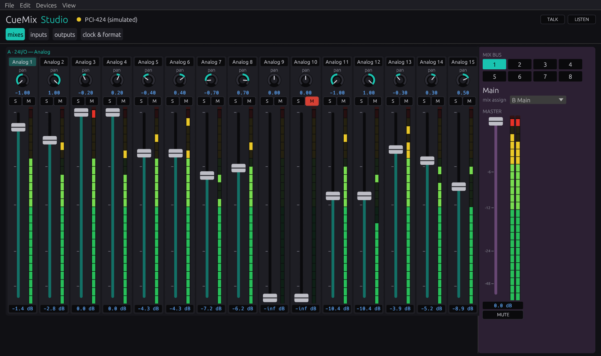
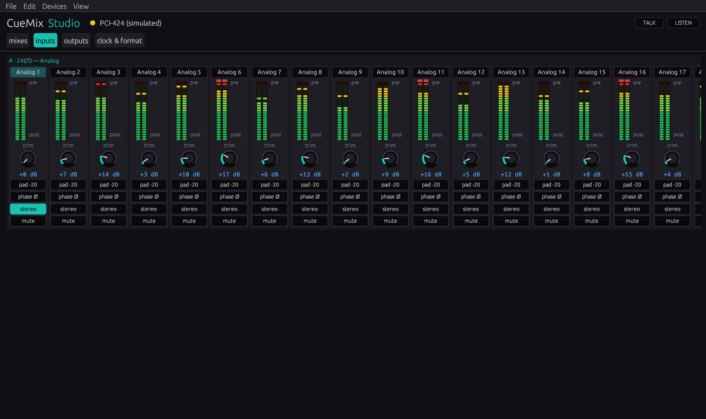
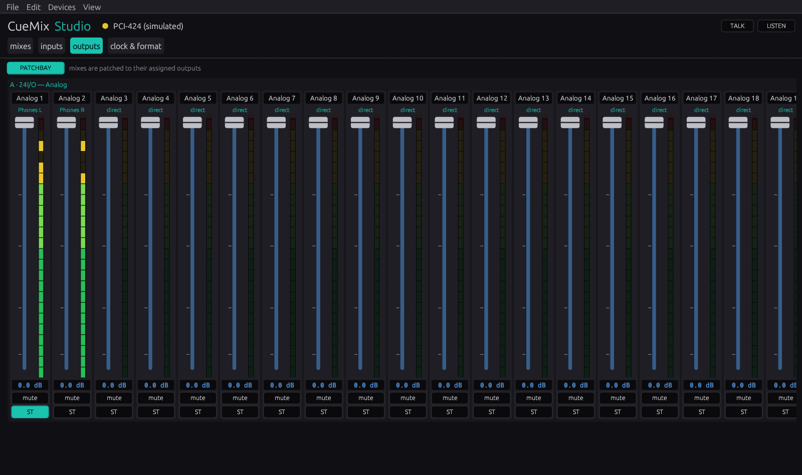
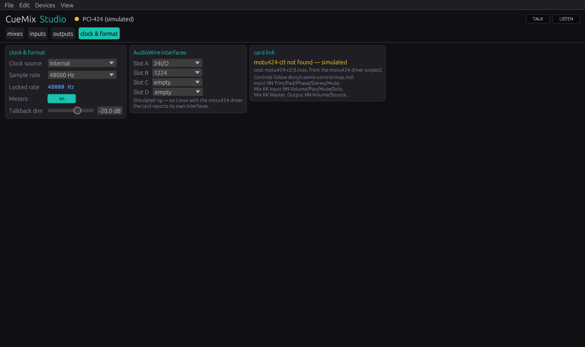
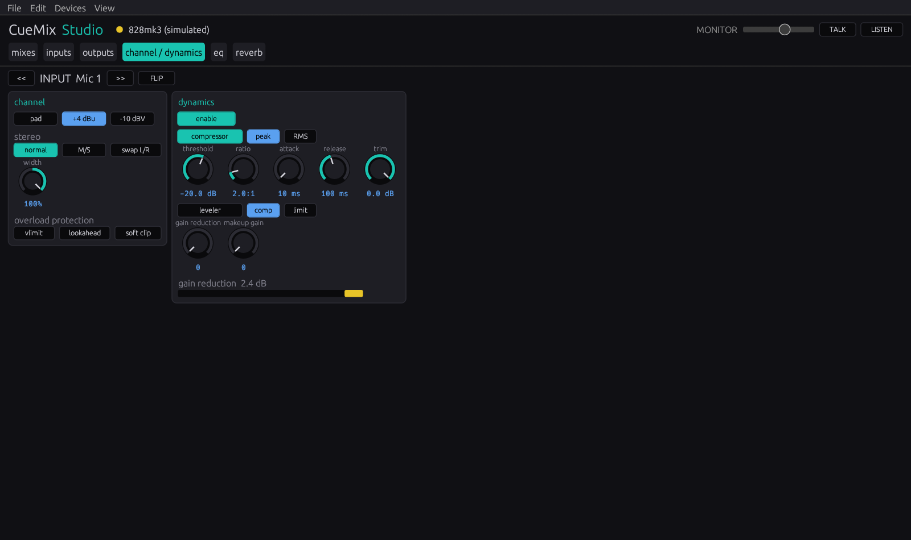
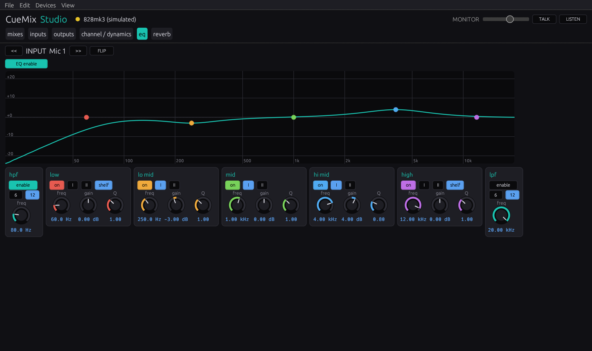
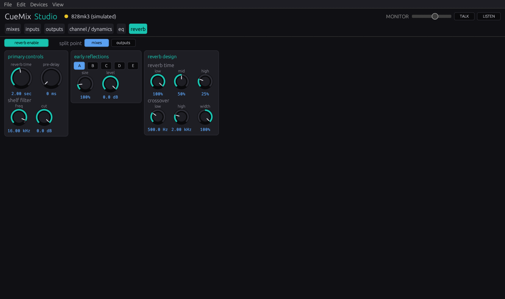

# motu-pci-424
**For PCIe please refeer to : https://github.com/devfrp/Linux-motu-pci-424/tree/branche-PCIe**

*Read this in: **English** · [Français](README.fr.md)*

🌐 **Website:** <https://devfrp.github.io/Linux-motu-pci-424/>

A from-scratch Linux ALSA driver for the **MOTU PCI-324 / PCI-424** audio card
and its AudioWire breakout interfaces (2408, 24I/O, 828, HD192, 896HD, …).

> **Status: the card boots under Linux; audio has not played yet.** The
> PCI / IRQ / ALSA machinery is complete. On a real PCI-424 the driver's load
> sequence (FPGA image through the DSP's GPIO, DSP program, mailbox) has been
> run with `tools/motu424-bringup`, and the driver now does the same when it binds
> with `request_firmware()` (see [Firmware](#firmware)). Audio is DSP
> bus-master DMA from a host ring. On a real card the load, the vendor's
> device configure and the stream all run, and the card detects its AudioWire
> interfaces, but the interfaces never lock to it, so nothing plays. Every
> host-visible register and DSP word now matches a locked Windows card; the
> missing piece is in the card-to-interface direction and needs a scope or a
> traced Windows VM to find ([`docs/transport.md`](docs/transport.md), Open).
> Streaming stays off unless `motu424.frame_bytes=96`.
> Playback only, 48 kHz only, PCI-424 (`137a:0004`) only for now.

## Quick start

```sh
curl -fsSL https://raw.githubusercontent.com/devfrp/Linux-motu-pci-424/main/get.sh | sh
```

Installs on any distro (deps + DKMS module + tools). Details and options under
[Install](#install-any-distro).

## Layout

| Path | Role |
|------|------|
| `kernel/motu424.h` | Shared defs + the **RE'd hardware model** (single source of truth) |
| `kernel/motu424_main.c` | PCI attach/detach, resource + IRQ management, interrupt handler |
| `kernel/motu424_hw.c` | **Hardware abstraction — the only file with real register semantics** |
| `kernel/motu424_pcm.c` | ALSA PCM callbacks (playback; capture once the ring layout is known) |
| `kernel/rust/` | **The same driver in Rust** (`hw.rs` mirrors `motu424_hw.c`): needs a `CONFIG_RUST` kernel, not yet run on a card. See [Rust kernel module](#rust-kernel-module) |
| `tools/` | **The userspace tools, all Rust**: one Cargo workspace, `make tools` builds them into `tools/target/release/` |
| `tools/motu424-ctl` | **CueMix-style management CLI** (clock/format + monitor mixer) over alsa-lib |
| `tools/cuemix-studio` | **Mixing console** (Rust/egui, Linux/macOS/Windows): drives the card via `motu424-ctl` on Linux, simulated rig elsewhere; adds the 828mk3 EQ/dynamics/reverb pages |
| `tools/motu424-probe` | BAR enumerator/dumper (windowed model) for reverse engineering |
| `tools/motu424-portregs` | Read-only decode of the three I/O-port registers (HSR/HDCR/DSPP, TI SPRU581C) |
| `tools/motu424-bringup` | **Bring-up replay** (dry-run by default): FPGA load via DSP GPIO, DSP program load, DSPINT, mailbox poll |
| `tools/motu424-ringwatch` | Read-only sampler of the DSP's ring position while the driver streams; `--dump` saves the DSP RAM |
| `tools/stream-run.sh` | Scripted stream test around `motu424-ringwatch` (load, 12 s of `speaker-test`, unload) |
| `tools/motu424-card` | The library the card tools share (sysfs lookup, BAR mapping, port I/O) |
| `tools/re/` | Static-RE helpers: `extract-firmware`, `dis-c64x` (C64x), `xref`, `vtable-scan`, `re-devext`, `disasm-va`, `ram-diff` |
| `get.sh` | **`curl \| sh` bootstrap** — fetch sources + run the installer |
| `install.sh` | **Cross-distro installer** (deps + DKMS + tools) |
| `ARCHITECTURE.md` | Design notes: the 3-layer split + hardware-confinement rule |
| `CLEANROOM.md` | Clean-room & provenance statement (legal basis, RE method) |
| `docs/index.html` | Project website (GitHub Pages landing page) |
| `dkms.conf` | DKMS packaging for automatic rebuilds across kernels |

The design goal: **all uncertainty is confined to `motu424.h` + `motu424_hw.c`.**
Once the true register layout is known, only those two files change, plus
`kernel/rust/hw.rs`, their port in the Rust module.

## Install (any distro)

One line — fetches the sources and runs the installer:

```sh
curl -fsSL https://raw.githubusercontent.com/devfrp/Linux-motu-pci-424/main/get.sh | sh
# pass installer options through:
curl -fsSL https://raw.githubusercontent.com/devfrp/Linux-motu-pci-424/main/get.sh | sh -s -- --no-dkms -y
```

Or clone and run the installer directly. It detects your package manager
(pacman/apt/dnf/yum/zypper/apk/xbps), pulls the build dependencies, installs the
module via **DKMS** (so it survives kernel upgrades) and installs the tools:

```sh
./install.sh              # deps + DKMS + tools + load  (uses sudo as needed)
./install.sh -y           # non-interactive package installs
./install.sh --no-dkms    # plain in-tree build + install instead of DKMS
./install.sh --rust       # the Rust module instead of the C one (CONFIG_RUST kernels)
./install.sh --uninstall  # remove module + tools
./install.sh -h           # all options
```

Under `curl | sh`, the installer detects the absence of a terminal and
automatically switches package installs to non-interactive mode; sudo still
prompts for your password on the terminal as usual.

## Build (manual)

Requires kernel headers for the running kernel (Arch: `linux-rt-headers` for an
RT kernel, or `linux-headers` otherwise) and `alsa-lib` for `motu424-ctl`.

```sh
make            # build module + tools
make load       # insmod kernel/motu424.ko
dmesg | tail    # look for "MOTU PCI-4xx registered as ALSA card N"
aplay -l        # the card should appear
make unload
```

### Rust kernel module

`kernel/rust/` is the same driver written in Rust: the PCI driver, the FPGA and
DSP program load (with its SHA-256 check), streaming, the IRQ and the teardown
order are Rust, and `hw.rs` follows `motu424_hw.c` step for step. The ALSA card
and the module parameters stay in a small C file (`motu424_alsa.c`), because
the kernel has no Rust bindings for ALSA and Rust module parameters are
integers only. It builds to the same `motu424.ko`, with the same parameters,
PCI IDs and firmware names, so load one or the other, not both.

**It has not run on a card yet.** The C module in `kernel/` is the one tested
on a real PCI-424 and stays the default.

It needs a kernel built with `CONFIG_RUST`, and the exact `rustc` that built
that kernel (`grep RUSTC_VERSION_TEXT /lib/modules/$(uname -r)/build/.config`
shows it; on Arch it is the `rust` package, not rustup):

```sh
make module-rust   # build kernel/rust/motu424.ko
make load-rust     # insmod it
./install.sh --rust   # or install it (no DKMS) instead of the C module
```

### Managing the card (CueMix for Linux)

`tools/motu424-ctl` is the userspace control app — the Linux equivalent of MOTU's
CueMix FX. It auto-locates the MOTU card and manages the driver's ALSA mixer
kcontrols (clock source, sample rate, per-input trim/pad/phase, and the input×bus
monitor matrix). Control set + naming: [`docs/cuemix-control-map.md`](docs/cuemix-control-map.md).

```sh
make tools                                      # needs Cargo; motu424-ctl needs alsa-lib
tools/target/release/motu424-ctl                # CueMix-style status overview
tools/target/release/motu424-ctl list           # every control
tools/target/release/motu424-ctl set 'Clock Source' Internal
tools/target/release/motu424-ctl set 'Mix 00 Input 03 Volume' 92
```

The mixer controls are Phase 5 (card-gated); the app is written to light up
automatically as the driver registers them, and degrades cleanly when absent.

#### Graphical console (cuemix-studio)

[`tools/cuemix-studio`](tools/cuemix-studio/README.md) is a CueMix FX-style
mixing console, a single Rust/egui binary for Linux, macOS and Windows. On
Linux with the driver it drives the card through `motu424-ctl`, so the tested
CLI stays the single source of truth; anywhere else, or with no card, it runs
a simulated PCI-424 rig (24I/O in slot A, 1224 in slot B). A second device,
the 828mk3, adds the channel/dynamics, EQ and reverb pages. It replaced the
earlier Python/GTK4 `motu424-gui`.

```sh
./install.sh --gui                              # build + install, with a desktop entry
make gui                                        # or just build it
tools/target/release/cuemix-studio              # the card if motu424-ctl finds one, else simulated
tools/target/release/cuemix-studio --simulate   # never touch the card
tools/target/release/cuemix-studio --828mk3     # the effects-capable device
```

The mixer kcontrols are Phase 5 (card-gated): with no MOTU card the console
runs its simulated rig; on real hardware it fills in once the driver
registers its controls.

##### Screenshots

The simulated rig, one tab at a time (taken with `--screenshot`).

**Mixes**: pan, solo, mute and fader per input for the selected mix bus, its
master on the right:



**Inputs** and **Outputs**: pre/post meters, trim, pad, phase and stereo per
input; one fader, meter, mute and stereo link per output, under the patchbay
switch:

 

**Clock & format**: clock source, sample rate, AudioWire slots and the card
link:



**828mk3**: channel and dynamics, the seven-band EQ, and the reverb:

  

## Firmware

The PCI-424's FPGA has no configuration PROM, so the host loads it, and the
DSP program, every time the driver binds (as the Windows driver does). Both
images belong to MOTU and are **not** shipped here. Extract them from your own
copy of the vendor driver and install them:

```sh
make tools                                               # builds extract-firmware (Rust)
tools/target/release/extract-firmware path/to/MOTUAW.sys # 32-bit driver; writes vendor/firmware/ (git-ignored)
sudo install -Dm644 vendor/firmware/pci424-serial-container.bin \
    /lib/firmware/motu424/pci424-serial-container.bin
sudo install -Dm644 vendor/firmware/pci424-program.bin \
    /lib/firmware/motu424/pci424-program.bin
```

The driver checks both by length and SHA-256 and refuses to probe if either is
missing or different. The load took about 15 s from userspace on the test card (894k GPIO writes), then
`dmesg` shows `DSP running: audio_base=0x6fac ...`.

Optional, for testers: `/lib/firmware/motu424/pci424-mixer.bin`, a CueMix
mixer program saved from a card that Windows configured. Warm-reboot from
Windows, dump the DSP RAM with `sudo tools/target/release/motu424-ringwatch --dump
ram.bin` before loading the driver, then cut out the program that `+0x78`
points to, up to and including its trailer `e2 00 1c 00 e2 03 98 07 00 80 00
00`. On the test card that was 0x4fc bytes at `0x32800`:
`dd if=ram.bin of=pci424-mixer.bin bs=1 skip=$((0x32800)) count=$((0x4fc))`.
It is your own routing data and is never shipped. If the file is present,
the driver hands it to the DSP at load (`docs/transport.md`, Device
configure).

## Reverse engineering

The hardware model comes from the vendor Windows driver `MOTUAW.sys` (static
RE with `objdump` and the `vtable-scan` and `xref` helpers in `tools/re/`),
from the card's own DSP program (`dis-c64x`), and from runs on a real
PCI-424 in issue #2:

- **The board** is a TI **TMS320C6412 DSP** in PCI boot mode plus an FPGA with
  no PROM. The I/O BAR is the DSP's Host Port Interface (HSR/HDCR/DSPP); the
  8 MB BAR (window A) is the DSP's peripheral registers, the 4 MB one
  (window B) its memory, with internal RAM at `0..0x3ffff`.
- **Bring-up** (vendor `fn 0x2c150`, run on hardware): WARMRESET, the FPGA
  image clocked out through the DSP's GPIO, the 28,272-byte C64x program
  written into internal RAM, DSPINT, then the program publishes `audio_base`
  in the mailbox at `0x3fffc` (`0x6fac`).
- **The audio block** at `audio_base` is the DSP program's global data:
  `mix_base` at `+0`, the host ring address at `+0x5c`, the DSP's position at
  `+0x2c`, start/stop at `+0x54`/`+0xf4`, frames per interrupt at `+0x60`.
- **Transport is DSP bus-master DMA.** The host hands the DSP a coherent ring
  (512 KB on Windows); the DSP fetches audio from it and raises an interrupt
  every 64 frames. IRQ pending = HSR bit 1; ack = `0x10` (INTRST) to the DSP's
  RSTSRC register.
- **CueMix control set** decoded from the shipped `CueMixFX-PCI-424.touchosc`
  (MOTU's CueMix OSC API): an input×mix-bus monitor matrix + per-input analog
  conditioning + clock/format. Drives `tools/motu424-ctl` — see
  [`docs/cuemix-control-map.md`](docs/cuemix-control-map.md).

Detailed, evidence-tagged write-ups live in `docs/`:
[`register-map.md`](docs/register-map.md), [`transport.md`](docs/transport.md),
[`fpga-upload.md`](docs/fpga-upload.md),
[`cuemix-control-map.md`](docs/cuemix-control-map.md),
[`vendor-driver-map.md`](docs/vendor-driver-map.md).

Still open: the frame layout on the host ring (bytes per frame, sample
format, channel order), where capture lands on the host side, rate changes
(the vendor relock sequence), and the PCI-324 / PCIe-424 load paths.

The full phased roadmap from here to a 100% working driver lives in
[`docs/REVERSE_ENGINEERING_PLAN.md`](docs/REVERSE_ENGINEERING_PLAN.md).

## Contributors
- @Audiosyncrasy: the tests on a real PCI-424 ([issue #2](https://github.com/devfrp/Linux-motu-pci-424/issues/2)) and the ring-watch tools ([PR #11](https://github.com/devfrp/Linux-motu-pci-424/pull/11))
- @samplaman: the PCIe-424 reports ([issue #1](https://github.com/devfrp/Linux-motu-pci-424/issues/1))

## License

GPL-2.0-or-later. Kernel modules linking GPL-only ALSA symbols must be GPL.
